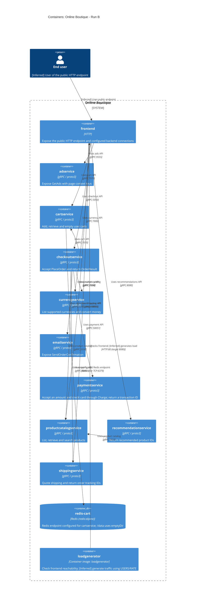

# Online Boutique — Run B architecture

## Agent

Codex — GPT-6. Language: English (default).

## Files read

Task instructions and authorized bookkeeping (not architectural evidence):

- `prompts/1-recover-architecture.md`
- `exercise/00-prompt-log.en.md`

Architectural evidence:

- `system/online-boutique/protos/demo.proto`
- `system/online-boutique/kubernetes-manifests/adservice.yaml`
- `system/online-boutique/kubernetes-manifests/cartservice.yaml`
- `system/online-boutique/kubernetes-manifests/checkoutservice.yaml`
- `system/online-boutique/kubernetes-manifests/currencyservice.yaml`
- `system/online-boutique/kubernetes-manifests/emailservice.yaml`
- `system/online-boutique/kubernetes-manifests/frontend.yaml`
- `system/online-boutique/kubernetes-manifests/kustomization.yaml`
- `system/online-boutique/kubernetes-manifests/loadgenerator.yaml`
- `system/online-boutique/kubernetes-manifests/paymentservice.yaml`
- `system/online-boutique/kubernetes-manifests/productcatalogservice.yaml`
- `system/online-boutique/kubernetes-manifests/README.md`
- `system/online-boutique/kubernetes-manifests/recommendationservice.yaml`
- `system/online-boutique/kubernetes-manifests/shippingservice.yaml`

## Containers table

Implementation languages and frameworks for the application services and loadgenerator: **Not evidenced in the provided files**. The table records the interface technology or explicit image instead. Responsibilities describe API contracts and manifest configuration, not verified runtime behavior.

| Name | Technology/language | Responsibility | Evidence |
|---|---|---|---|
| `frontend` | HTTP | Expose the public HTTP endpoint and configured backend connections | `system/online-boutique/kubernetes-manifests/frontend.yaml` (image, line 47; service ports and selectors, lines 108–136; backend env, lines 69–84) |
| `adservice` | gRPC / proto3 | Expose GetAds with page context keys | `system/online-boutique/kubernetes-manifests/adservice.yaml` (image, line 46; grpc service port, lines 81–83); `system/online-boutique/protos/demo.proto` (AdService.GetAds and AdRequest.context_keys, lines 243–250) |
| `cartservice` | gRPC / proto3 | Add, retrieve and empty user carts | `system/online-boutique/kubernetes-manifests/cartservice.yaml` (image, line 46; REDIS_ADDR, lines 50–51; grpc service port, lines 80–82); `system/online-boutique/protos/demo.proto` (CartService, lines 23–27) |
| `checkoutservice` | gRPC / proto3 | Accept PlaceOrder and return OrderResult | `system/online-boutique/kubernetes-manifests/checkoutservice.yaml` (image, line 45; backend env, lines 57–68; grpc service port, lines 88–90); `system/online-boutique/protos/demo.proto` (CheckoutService.PlaceOrder and PlaceOrderResponse.order, lines 224–239) |
| `currencyservice` | gRPC / proto3 | List supported currencies and convert money | `system/online-boutique/kubernetes-manifests/currencyservice.yaml` (image, line 46; grpc service port, lines 80–82); `system/online-boutique/protos/demo.proto` (CurrencyService, lines 140–143) |
| `emailservice` | gRPC / proto3 | Expose SendOrderConfirmation | `system/online-boutique/kubernetes-manifests/emailservice.yaml` (image, line 46; grpc service port 5000 to targetPort 8080, lines 81–83); `system/online-boutique/protos/demo.proto` (EmailService.SendOrderConfirmation, lines 199–201) |
| `paymentservice` | gRPC / proto3 | Accept an amount and credit card through Charge; return a transaction ID | `system/online-boutique/kubernetes-manifests/paymentservice.yaml` (image, line 46; grpc service port, lines 79–81); `system/online-boutique/protos/demo.proto` (PaymentService.Charge, ChargeRequest and ChargeResponse, lines 177–195) |
| `productcatalogservice` | gRPC / proto3 | List, retrieve and search products | `system/online-boutique/kubernetes-manifests/productcatalogservice.yaml` (image, line 46; grpc service port, lines 79–81); `system/online-boutique/protos/demo.proto` (ProductCatalogService, lines 71–75) |
| `recommendationservice` | gRPC / proto3 | Return recommended product IDs | `system/online-boutique/kubernetes-manifests/recommendationservice.yaml` (image, line 46; PRODUCT_CATALOG_SERVICE_ADDR, lines 60–61; grpc service port, lines 83–85); `system/online-boutique/protos/demo.proto` (RecommendationService.ListRecommendations and ListRecommendationsResponse, lines 56–67) |
| `shippingservice` | gRPC / proto3 | Quote shipping and return order tracking IDs | `system/online-boutique/kubernetes-manifests/shippingservice.yaml` (image, line 45; grpc service port, lines 79–81); `system/online-boutique/protos/demo.proto` (ShippingService.GetQuote / ShipOrder and response messages, lines 107–128) |
| `redis-cart` | Redis (redis:alpine) | Redis endpoint configured for cartservice; /data uses emptyDir | `system/online-boutique/kubernetes-manifests/cartservice.yaml` (REDIS_ADDR, lines 50–51; redis-cart Deployment/image, lines 89–120; /data volume and emptyDir, lines 129–141; tcp-redis service port, lines 154–156) |
| `loadgenerator` | Container image: loadgenerator | Check frontend reachability; [Inferred] generate traffic using USERS/RATE | `system/online-boutique/kubernetes-manifests/loadgenerator.yaml` (Deployment, lines 14–19; frontend-check HTTP request, lines 40–70; image and env, lines 80–87); `system/online-boutique/kubernetes-manifests/kustomization.yaml` (loadgenerator resource commented out, line 24) |

The diagram includes loadgenerator because its Deployment is supplied, but it is excluded from the base Kustomization (`system/online-boutique/kubernetes-manifests/kustomization.yaml` (line 24)). Its frontend-check init container belongs to that workload (`system/online-boutique/kubernetes-manifests/loadgenerator.yaml` (lines 40–70)). frontend and frontend-external are endpoints selecting the same frontend workload, not additional C4 containers (`system/online-boutique/kubernetes-manifests/frontend.yaml` (lines 108–136)).

## Dependencies table

These are configured connections. The caller manifest supplies the address; the target Service port named grpc and the matching proto service identify the gRPC interface. Which RPC methods each caller actually invokes is **Not evidenced in the provided files**. The end user is an [Inferred] actor representing use of the public HTTP endpoint.

| Caller → callee | Label | Protocol | Evidence |
|---|---|---|---|
| End user → `frontend` | [Inferred] Uses public endpoint | HTTP:80 (target 8080) | `system/online-boutique/kubernetes-manifests/frontend.yaml` (frontend-external LoadBalancer; app: frontend selector; http port 80 to 8080, lines 123–136); the human caller is [Inferred] |
| `frontend` → `productcatalogservice` | Uses product catalog | gRPC:3550 | `system/online-boutique/kubernetes-manifests/frontend.yaml` (PRODUCT_CATALOG_SERVICE_ADDR=productcatalogservice:3550, lines 69–70); `system/online-boutique/kubernetes-manifests/productcatalogservice.yaml` (Service port named grpc, lines 79–81); `system/online-boutique/protos/demo.proto` (ProductCatalogService) |
| `frontend` → `currencyservice` | Uses currency API | gRPC:7000 | `system/online-boutique/kubernetes-manifests/frontend.yaml` (CURRENCY_SERVICE_ADDR=currencyservice:7000, lines 71–72); `system/online-boutique/kubernetes-manifests/currencyservice.yaml` (Service port named grpc, lines 80–82); `system/online-boutique/protos/demo.proto` (CurrencyService) |
| `frontend` → `cartservice` | Uses cart API | gRPC:7070 | `system/online-boutique/kubernetes-manifests/frontend.yaml` (CART_SERVICE_ADDR=cartservice:7070, lines 73–74); `system/online-boutique/kubernetes-manifests/cartservice.yaml` (Service port named grpc, lines 80–82); `system/online-boutique/protos/demo.proto` (CartService) |
| `frontend` → `recommendationservice` | Uses recommendations API | gRPC:8080 | `system/online-boutique/kubernetes-manifests/frontend.yaml` (RECOMMENDATION_SERVICE_ADDR=recommendationservice:8080, lines 75–76); `system/online-boutique/kubernetes-manifests/recommendationservice.yaml` (Service port named grpc, lines 83–85); `system/online-boutique/protos/demo.proto` (RecommendationService) |
| `frontend` → `shippingservice` | Uses shipping API | gRPC:50051 | `system/online-boutique/kubernetes-manifests/frontend.yaml` (SHIPPING_SERVICE_ADDR=shippingservice:50051, lines 77–78); `system/online-boutique/kubernetes-manifests/shippingservice.yaml` (Service port named grpc, lines 79–81); `system/online-boutique/protos/demo.proto` (ShippingService) |
| `frontend` → `checkoutservice` | Uses checkout API | gRPC:5050 | `system/online-boutique/kubernetes-manifests/frontend.yaml` (CHECKOUT_SERVICE_ADDR=checkoutservice:5050, lines 79–80); `system/online-boutique/kubernetes-manifests/checkoutservice.yaml` (Service port named grpc, lines 88–90); `system/online-boutique/protos/demo.proto` (CheckoutService) |
| `frontend` → `adservice` | Uses ads API | gRPC:9555 | `system/online-boutique/kubernetes-manifests/frontend.yaml` (AD_SERVICE_ADDR=adservice:9555, lines 81–82); `system/online-boutique/kubernetes-manifests/adservice.yaml` (Service port named grpc, lines 81–83); `system/online-boutique/protos/demo.proto` (AdService) |
| `checkoutservice` → `productcatalogservice` | Uses product catalog | gRPC:3550 | `system/online-boutique/kubernetes-manifests/checkoutservice.yaml` (PRODUCT_CATALOG_SERVICE_ADDR=productcatalogservice:3550, lines 57–58); `system/online-boutique/kubernetes-manifests/productcatalogservice.yaml` (Service port named grpc, lines 79–81); `system/online-boutique/protos/demo.proto` (ProductCatalogService) |
| `checkoutservice` → `shippingservice` | Uses shipping API | gRPC:50051 | `system/online-boutique/kubernetes-manifests/checkoutservice.yaml` (SHIPPING_SERVICE_ADDR=shippingservice:50051, lines 59–60); `system/online-boutique/kubernetes-manifests/shippingservice.yaml` (Service port named grpc, lines 79–81); `system/online-boutique/protos/demo.proto` (ShippingService) |
| `checkoutservice` → `paymentservice` | Uses payment API | gRPC:50051 | `system/online-boutique/kubernetes-manifests/checkoutservice.yaml` (PAYMENT_SERVICE_ADDR=paymentservice:50051, lines 61–62); `system/online-boutique/kubernetes-manifests/paymentservice.yaml` (Service port named grpc, lines 79–81); `system/online-boutique/protos/demo.proto` (PaymentService) |
| `checkoutservice` → `emailservice` | Uses order confirmation API | gRPC:5000 (target 8080) | `system/online-boutique/kubernetes-manifests/checkoutservice.yaml` (EMAIL_SERVICE_ADDR=emailservice:5000, lines 63–64); `system/online-boutique/kubernetes-manifests/emailservice.yaml` (Service port named grpc, lines 81–83); `system/online-boutique/protos/demo.proto` (EmailService) |
| `checkoutservice` → `currencyservice` | Uses currency API | gRPC:7000 | `system/online-boutique/kubernetes-manifests/checkoutservice.yaml` (CURRENCY_SERVICE_ADDR=currencyservice:7000, lines 65–66); `system/online-boutique/kubernetes-manifests/currencyservice.yaml` (Service port named grpc, lines 80–82); `system/online-boutique/protos/demo.proto` (CurrencyService) |
| `checkoutservice` → `cartservice` | Uses cart API | gRPC:7070 | `system/online-boutique/kubernetes-manifests/checkoutservice.yaml` (CART_SERVICE_ADDR=cartservice:7070, lines 67–68); `system/online-boutique/kubernetes-manifests/cartservice.yaml` (Service port named grpc, lines 80–82); `system/online-boutique/protos/demo.proto` (CartService) |
| `recommendationservice` → `productcatalogservice` | Uses product catalog | gRPC:3550 | `system/online-boutique/kubernetes-manifests/recommendationservice.yaml` (PRODUCT_CATALOG_SERVICE_ADDR=productcatalogservice:3550, lines 60–61); `system/online-boutique/kubernetes-manifests/productcatalogservice.yaml` (Service port named grpc, lines 79–81); `system/online-boutique/protos/demo.proto` (ProductCatalogService) |
| `cartservice` → `redis-cart` | Uses configured Redis endpoint | Redis over TCP:6379 | `system/online-boutique/kubernetes-manifests/cartservice.yaml` (REDIS_ADDR=redis-cart:6379, lines 50–51; redis:alpine, line 118; tcp-redis service port, lines 154–156) |
| `loadgenerator` → `frontend` | Checks frontend; [Inferred] generates load | HTTP:80 (target 8080) | `system/online-boutique/kubernetes-manifests/loadgenerator.yaml` (frontend-check uses http://${FRONTEND_ADDR}, line 49; FRONTEND_ADDR=frontend:80 in init and main containers, lines 69–70 and 82–83; USERS/RATE, lines 84–87); `system/online-boutique/kubernetes-manifests/frontend.yaml` (http Service port 80 to 8080, lines 119–121) |

## Mermaid diagram

## Gaps

The additional paths below are proposed follow-up files, not files opened in this run; their availability has not been verified.

| Gap | Evidence boundary | Extra file that would settle it |
|---|---|---|
| Implementation languages/frameworks | Not evidenced in the provided files. Image names and the proto go_package option do not establish each service implementation. | The Dockerfile for each application image, e.g. `system/online-boutique/src/frontend/Dockerfile`; corresponding `system/online-boutique/src/<service>/Dockerfile` and build/project manifest. |
| Exact call methods, ordering and failure handling | Not evidenced in the provided files. Address variables establish configured targets; RPC contracts do not establish caller behavior, retries, timeouts or checkout compensation. | Candidate entrypoints/client code: `system/online-boutique/src/frontend/rpc.go` and `system/online-boutique/src/checkoutservice/main.go`. |
| shoppingassistantservice deployment, activation and protocol | `system/online-boutique/kubernetes-manifests/frontend.yaml` (SHOPPING_ASSISTANT_SERVICE_ADDR=shoppingassistantservice:80, lines 83–84; ENABLE_ASSISTANT commented out, lines 93–94) records a reference; `system/online-boutique/kubernetes-manifests/kustomization.yaml` (shopping-assistant component commented out, line 35) does not activate a deployment. A matching container and its protocol are Not evidenced in the provided files, so it is omitted from the tables and diagram. | `system/online-boutique/kustomize/components/shopping-assistant/kustomization.yaml` and the manifests it includes; candidate flag handling in `system/online-boutique/src/frontend/main.go`. |
| Optional packaging integration | `system/online-boutique/kubernetes-manifests/frontend.yaml` (optional packaging service comment and commented PACKAGING_SERVICE_URL, lines 97–99) does not establish an active runtime dependency. Its deployment and API are Not evidenced in the provided files. | Candidate integration code in `system/online-boutique/src/frontend/main.go` and the deployment configuration that sets PACKAGING_SERVICE_URL. |
| Real payment, shipping or email providers | External provider calls and protocols are Not evidenced in the provided files. Charge, ShipOrder and SendOrderConfirmation are contracts, not evidence of an external gateway, carrier or SMTP service (`system/online-boutique/protos/demo.proto` (PaymentService, ShippingService, EmailService)). No external system is added to the diagram. | Candidate implementations: `system/online-boutique/src/paymentservice/index.js`, `system/online-boutique/src/shippingservice/main.go`, `system/online-boutique/src/emailservice/email_server.py`. |
| Data sources, Redis contents and order persistence | Redis configuration and its emptyDir volume are evidenced (`system/online-boutique/kubernetes-manifests/cartservice.yaml` (REDIS_ADDR, lines 50–51; volume, lines 129–141)). Key layout, expiry, catalog/currency data sources and any order database are Not evidenced in the provided files; no further data store or broker is added. | Candidate implementations: `system/online-boutique/src/cartservice/src/cartstore/RedisCartStore.cs`, `system/online-boutique/src/productcatalogservice/main.go`, `system/online-boutique/src/currencyservice/server.js`, `system/online-boutique/src/checkoutservice/main.go`. |
| Final deployed composition and image versions | `system/online-boutique/kubernetes-manifests/README.md` (lines 3–8) says these image names require Skaffold substitution; `system/online-boutique/kubernetes-manifests/kustomization.yaml` (lines 17–28) excludes loadgenerator. Actual deployed versions and whether another configuration enables loadgenerator are Not evidenced in the provided files. | `system/online-boutique/skaffold.yaml` and the rendered deployment manifest for the environment being examined. |
| Human-facing behavior, authentication and TLS | The public http endpoint is evidenced (`system/online-boutique/kubernetes-manifests/frontend.yaml` (lines 123–136)), but the human actor is [Inferred]. UI routes, authentication and TLS termination elsewhere are Not evidenced in the provided files. | Candidate handlers in `system/online-boutique/src/frontend/handlers.go` and the environment ingress/gateway manifest, if one exists. |
